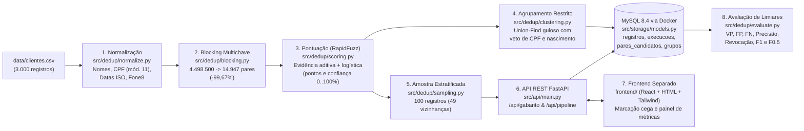
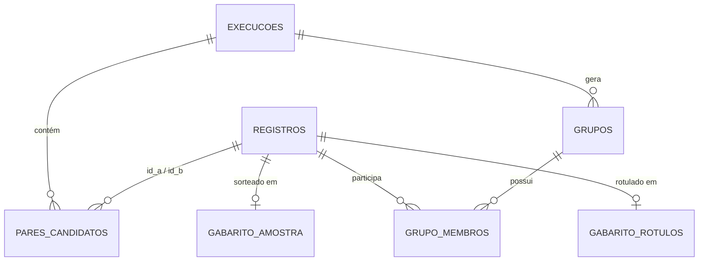

# Arquitetura do Pipeline de Deduplicação

Este documento apresenta o fluxo de dados e componentes da Fase 1 (Pipeline de Deduplicação, Persistência e Avaliação por Gabarito).

---

## Diagrama do Fluxo do Pipeline

---

## Modelo de Dados (`src/storage/models.py`)

